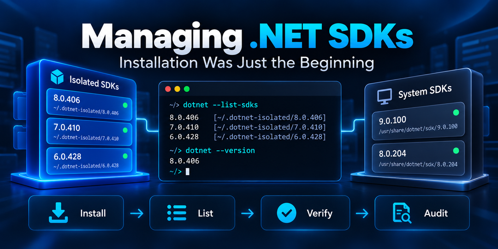

In September, I wrote about [testing a new .NET SDK without installing it system-wide](/post/2026/09/20/how-to-test-a-new-dotnet-sdk-without-installing-it-system-wide).

In that article, I introduced a small project I'd been working on called [Isolated .NET SDK](https://github.com/infoconex/isolated-dotnet-sdk).

I described it this way:

> It still uses Microsoft's official `dotnet-install` scripts underneath. The project just handles the workflow around them.

That was accurate when I wrote it.

By the time I released [Isolated .NET SDK v0.4.0](https://github.com/infoconex/isolated-dotnet-sdk/releases/tag/v0.4.0) on October 17, less than a month later, it wasn't anymore.

I hadn't planned on building an SDK management tool. I wanted a convenient way to test different .NET SDK versions without changing my normal development environment.

But as the project evolved, I found there was more to managing an isolated SDK than getting it installed.

## What Is Isolated .NET SDK?

Isolated .NET SDK is a cross-platform tool for installing, listing, verifying, auditing, and removing specific .NET SDK versions without modifying your normal system-wide SDK installations.

It supports Windows through PowerShell 7 and Linux and macOS through Bash. SDKs are installed into separate, user-owned directories without permanently changing the system's PATH.

Isolation refers to where SDKs are installed. **It isn't a security sandbox.**

## How Is Isolated .NET SDK Different from Microsoft's Installer Scripts?

Microsoft provides two `dotnet-install` scripts: `dotnet-install.ps1` for Windows and `dotnet-install.sh` for Linux and macOS.

They provide a convenient way to install .NET SDKs into selected directories. That's where I started, and they're still useful for many situations.

My original tool simplified the process of selecting, installing, and removing SDK versions.

But installation raised some questions.

How do I know the downloaded SDK is actually the version I requested? What happens if installation fails halfway through? How do I avoid leaving behind something that looks installed but isn't usable?

Starting with v0.2.0, Isolated .NET SDK moved away from relying on Microsoft's installation scripts.

Instead, it uses Microsoft's published release metadata to identify the exact SDK archive, verifies the download against Microsoft's published checksum, and validates the SDK's version and isolated location before completing installation.

Both approaches use Microsoft's official SDK distributions. The difference is that Isolated .NET SDK takes responsibility for downloading, validating, and managing SDK installations rather than delegating installation to Microsoft's scripts.

## Installing an SDK Wasn't the End of the Problem

Once I could install SDKs into separate directories, I needed a better way to manage them.

Here's the main menu from v0.4.0:

```text
Isolated .NET SDK v0.4.0

What would you like to do?

  I. Install an SDK
  R. Remove an isolated SDK
  L. List installed SDKs
  V. Verify an isolated SDK
  A. Audit installed SDKs

  E. Exit

Selection:
```

The menu provides an overview of what the tool can do.

Three operations in particular help answer different questions that come up when working with multiple SDK versions.

### What's the Difference Between List, Verify, and Audit?

| Operation | Question answered | What it establishes |
|---|---|---|
| **List** | Which .NET SDKs are installed? | Discovered SDK versions and their installation locations |
| **Verify** | Does this isolated .NET SDK work? | Whether the installation is usable and the expected SDK resolves from its isolated directory |
| **Audit** | Are my installed SDKs current and supported? | Support lifecycle, servicing status, and available updates |

These distinctions matter.

An SDK can be installed without being usable. An SDK can be usable without being current. And an SDK can be current without being the version required by a particular application.

I wanted the tool to help distinguish those situations rather than treating every installed SDK as ready to use.

### List: Which Isolated and System-Wide .NET SDKs Are Installed?

The normal `dotnet --list-sdks` command doesn't necessarily show SDKs deliberately installed in separate locations.

**List** shows both isolated and system SDKs, keeping them separate so I can see what's installed and where.

```text
Installed .NET SDKs

Isolated SDKs:
  10.0.303  C:\Users\<user>\dotnet-sdks\10.0.303
  9.0.205   C:\Users\<user>\dotnet-sdks\9.0.205

System SDKs:
  10.0.402  C:\Program Files\dotnet\sdk\10.0.402
  10.0.401  C:\Program Files\dotnet\sdk\10.0.401
  9.0.319   C:\Program Files\dotnet\sdk\9.0.319
  8.0.426   C:\Program Files\dotnet\sdk\8.0.426
```

I have two isolated SDKs and four system SDKs.

For system-wide installations, List uses the SDK inventory reported by the normally resolved `dotnet` host. It doesn't attempt to find every SDK directory that might exist anywhere on the machine.

The distinction matters because the tool can inspect system SDKs, but it doesn't own them or attempt to remove them.

### Verify: Does This Isolated .NET SDK Work Correctly?

Finding an SDK directory doesn't mean the installation is healthy.

**Verify** checks whether a specific isolated SDK works, resolves to the expected version, and actually comes from its isolated directory.

Here's the result of verifying my isolated SDK `10.0.303`:

```text
Verify isolated .NET SDK

SDK information:
  SDK version         10.0.303
  .NET channel        10.0
  Support type        LTS
  Status              Active
  SDK release date    2026-08-11
  Channel EOS date    2028-11-14
  Update available    10.0.402

Installed components:
  Host version        10.0.11
  Architecture        x64
  Runtime identifier  win-x64

  .NET runtimes:
    Microsoft.AspNetCore.App      10.0.11
    Microsoft.NETCore.App         10.0.11
    Microsoft.WindowsDesktop.App  10.0.11

Verification:
  Installation directory  OK  C:\Users\<user>\dotnet-sdks\10.0.303
  .NET host               OK  Host executable found and launched
  SDK inventory           OK  Exact SDK found in isolated installation
  SDK resolution          OK  Correct SDK selected

Isolated SDK 10.0.303 verified successfully.
```

The isolated SDK is working correctly, even though a newer version is available.

Verify tells me whether the SDK installation is usable, not whether it's the latest version or whether my application will build successfully with it. Application compatibility still needs to be evaluated separately.

### Audit: Are My Installed .NET SDKs Current and Supported?

An SDK can work perfectly and still be outdated or out of support.

**Audit** uses Microsoft's release metadata to evaluate installed SDKs, identifying their lifecycle status and whether updates are available.

Here's the Audit result from the same machine:

```text
.NET SDK audit

Isolated SDKs:
  10.0.303  LTS  Active       Release: 2026-08-11  EOS: 2028-11-14  Update -> 10.0.402
  9.0.205   STS  Maintenance  Release: 2025-06-10  EOS: 2026-11-10  Update -> 9.0.319

System SDKs:
  10.0.402  LTS  Current      Release: 2026-10-13  EOS: 2028-11-14
  10.0.401  LTS  Active       Release: 2026-09-08  EOS: 2028-11-14  Update -> 10.0.402
  9.0.319   STS  Maintenance  Release: 2026-10-13  EOS: 2026-11-10
  8.0.426   LTS  Maintenance  Release: 2026-10-13  EOS: 2026-11-10
```

Notice that both isolated SDKs have updates available, and those newer versions are already installed system-wide.

That doesn't make the isolated installations invalid. They might be there intentionally for testing.

Audit gives me the information I need to decide whether to keep them, update them, or remove them.

Unlike Verify, Audit isn't determining whether an SDK installation works. It's evaluating installed versions against Microsoft's published release and support information.

An older SDK may still be needed to reproduce a historical build even when Microsoft no longer supports it.

It also connects directly to my [Staying Current with .NET](https://coding.infoconex.com/series/staying-current-with-dotnet/) series. I don't want to discover an unsupported SDK only when an upgrade becomes urgent.

While the interactive menu makes the tool convenient to use from a terminal, the same operations are available directly from the command line for scripts and automation.

I've also moved away from downloading the tool from a changing `main` branch. The recommended installation now uses verified scripts from published GitHub releases, with the option to select a specific version. The [GitHub repository](https://github.com/infoconex/isolated-dotnet-sdk) contains the installation instructions and command documentation.

## Handling Older .NET SDKs and Failed Removals

One of the more challenging areas of v0.4.0 was improving support for older .NET SDKs.

I initially approached installation and verification with the expectations you'd have from modern SDKs.

But older releases don't always follow the same conventions. Archive names, version mappings, and even available command-line capabilities can differ.

Supporting those versions meant accounting for the differences without weakening verification.

Removal presented its own challenges. A build process might still have files open, or an earlier installation might have left behind an incomplete directory.

Version 0.4.0 improves handling of these situations with more explicit safeguards.

Removing an SDK requires confirmation. The tool accounts for build-server shutdown, including compatibility handling for certain older SDK versions that don't support the same commands as modern releases. If a supported build-server shutdown fails, removal is blocked rather than assuming it's safe to proceed.

The tool can also identify incomplete installation directories and offer them for confirmed cleanup. If a removal is only partially completed because of locked files, the operation can be retried after those locks are released.

There are still limits. Some historical SDKs won't run on modern operating systems, and locked files can't always be removed immediately. Even a successful build-server shutdown doesn't guarantee that every process using an SDK has exited.

I'd rather have the tool report those limitations clearly than make an operation appear successful when it wasn't.

## Where This Leaves Me

One thing I was reminded of while building this tool is that getting something to work is often the easy part. Making it reliable, maintainable, and useful across different environments takes considerably more thought.

I'm pleased with where [Isolated .NET SDK v0.4.0](https://github.com/infoconex/isolated-dotnet-sdk/releases/tag/v0.4.0) has landed. There's always more that could be added, but I think it now addresses the problems I originally set out to solve, along with several I hadn't anticipated.

I can now return to what I originally planned for this series: using newer .NET tooling to understand an application's dependencies before attempting an upgrade.
