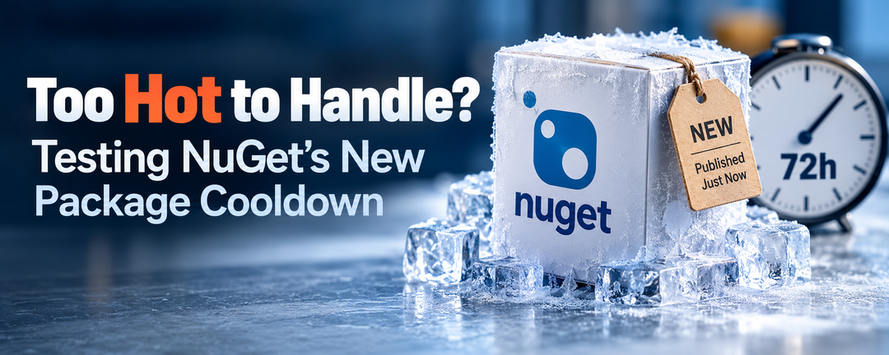

There's nothing quite like a NuGet package that's hot off the press.

A new version appears, promises improvements, fixes a few bugs, and before long we're thinking about updating our applications.

But what if that package is a little too hot?

With .NET 11 RC2, Microsoft added command-line support for configuring NuGet publication cooldowns. The idea is simple: rather than immediately adopting a newly published package version, give it some time to cool down.

That waiting period might give the community an opportunity to identify malicious packages before developers unknowingly introduce them into their applications.

It sounds like a reasonable security precaution.

But I had a question.

**If I configure a 72-hour cooldown, can a package published just minutes ago still end up in my application?**

I decided to find out.

As it turns out, the answer is yes.

## Why Would You Want to Cool Down a Package?

Software supply-chain attacks don't always involve unfamiliar packages with suspicious names.

An attacker might compromise a trusted package maintainer's account and publish a malicious version of a library that developers have been using for years.

When dependency-update tools detect a new release, they may recommend or select it before anyone realizes something is wrong.

A publication cooldown introduces a delay into certain package-selection workflows.

Imagine a package with two available versions:

| Version | Published |
|---|---|
| 1.0.0 | Seven days ago |
| 2.0.0 | One hour ago |

With a 72-hour cooldown, version 2.0.0 would not yet be eligible for cooldown-aware automatic selection.

If that version turns out to be malicious and someone discovers it during those 72 hours, developers using the cooldown may avoid adopting it.

Of course, there's a catch.

A package that remains undetected for 73 hours doesn't suddenly become safe.

**A cooldown gives us time for problems to be discovered. It doesn't discover those problems for us.**

That distinction becomes important when we look at how NuGet implements the feature.

## Configuring NuGet's Publication Cooldown

In \`nuget.config\`, we can specify a minimum publication age for a package source:

\`\`\`xml
<configuration>
  <packageSources>
    <clear />
    <add key="nuget.org"
         value="https://api.nuget.org/v3/index.json"
         minPublishAgeHours="72" />
  </packageSources>
</configuration>
\`\`\`

The setting, \`minPublishAgeHours\`, defines how many hours must pass before a package version becomes eligible for certain automatic selection operations. It applies to a package source, not globally to every dependency operation.

.NET 11 RC2 also supports configuring it from the command line. For a new source entry, for example:

\`\`\`powershell
dotnet nuget add source \`
    https://api.nuget.org/v3/index.json \`
    --name public \`
    --min-publish-age-hours 72 \`
    --configfile nuget.config
\`\`\`

But configuring a security feature and understanding what it actually protects are two different things.

I wanted to test its behavior before deciding how useful it would be.

## Setting Up a Controlled Experiment

I didn't want to change my normal .NET installation or publish disposable packages to nuget.org.

I used my [Isolated .NET SDK utility](https://github.com/infoconex/isolated-dotnet-sdk) to install the exact SDK version:

\`\`\`text
11.0.100-rc.2.26504.105
\`\`\`

This let me run .NET 11 RC2 without modifying my normal system-wide SDK installation or PATH.

Then I created a local NuGet feed containing two versions of a test package named \`Cooldown.Sample\`.

| Package version | Simulated publication age |
|---|---|
| 1.0.0 | 96 hours old |
| 2.0.0 | Just published |

NuGet uses the last-modified timestamp of a package file as its publication date when working with a local feed. That allowed me to control the package ages without waiting several days between tests.

I also created separate consumer projects and package caches to prevent earlier restores from influencing subsequent experiments.

After working through the tests manually, I consolidated the main experiments into a reproducible PowerShell script.

**You can run the same experiments yourself:** [NuGet Publication Cooldown POC on GitHub](https://github.com/infoconex/nuget-publication-cooldown-poc).

The repository includes instructions for installing the isolated SDK, creating the test environment, running five scenarios, and interpreting the results. All five scenarios passed on my Windows machine using .NET 11 RC2.

Here's what I learned.

## First, the Good News: The Cooldown Works

I began with a control test.

I created a project without any cooldown configuration and asked NuGet to add my package without specifying a version:

\`\`\`powershell
dotnet package add Cooldown.Sample
\`\`\`

NuGet selected version \`2.0.0\`, the newest available package.

Then I repeated the test with a 72-hour cooldown configured.

This time, NuGet selected version \`1.0.0\`.

| Configuration | Version selected |
|---|---|
| No cooldown | 2.0.0 |
| 72-hour cooldown | 1.0.0 |

So far, exactly what I expected.

The new version was available, but NuGet respected the cooldown when deciding which version to add.

Next, I tested an existing application already referencing version \`1.0.0\`. I ran:

\`\`\`powershell
dotnet package update Cooldown.Sample
\`\`\`

With the cooldown enabled, NuGet reported:

\`\`\`text
Packages with newer versions that have not reached
the configured minimum publish age: Cooldown.Sample.

All packages are up to date
\`\`\`

The application remained on version \`1.0.0\`.

One interesting detail: the update command returned exit code \`2\`.

For \`dotnet package update\`, that means there are no packages eligible for updating. It isn't necessarily an error.

That's something worth remembering when writing automation that treats every nonzero exit code as a failure.

At this point, both package addition and updating behaved as intended.

But then I changed the experiment.

## What If I Already Know Which Version I Want?

Instead of letting NuGet choose the version, I explicitly referenced the newer package:

\`\`\`xml
<PackageReference Include="Cooldown.Sample"
                  Version="[2.0.0]" />
\`\`\`

The brackets specify an exact version.

My 72-hour cooldown was still configured.

I ran \`dotnet restore\`, and NuGet restored version \`2.0.0\` successfully.

The package was still inside the cooldown period, yet it was part of my application's restored dependencies.

This was the most important finding of the investigation.

**A publication cooldown does not prevent an explicitly referenced recent package from being restored.**

Think about what that means for a development team.

Someone configures a 72-hour cooldown in the repository's \`nuget.config\`.

A developer manually updates a package reference to a version published an hour ago and commits the change.

The CI pipeline runs \`dotnet restore\`.

The cooldown doesn't reject that version.

This isn't a bug. It is consistent with Microsoft's design for the initial implementation.

The feature primarily influences assisted and automated package-version selection. It doesn't enforce a minimum publication age across every restored dependency.

That makes it useful, but narrower than the name might initially suggest.

## What About Floating Versions?

I also wanted to see what happened when a project used a floating package version:

\`\`\`xml
<PackageReference Include="Cooldown.Sample"
                  Version="2.*" />
\`\`\`

With the 72-hour cooldown enabled, restore failed:

\`\`\`text
error NU1020: The following PackageReference items
cannot specify a floating version because package
source cooldown is enabled: Cooldown.Sample.
\`\`\`

Rather than silently picking an older package, NuGet rejected the floating reference.

That's an important compatibility consideration.

If your applications use floating versions, enabling a publication cooldown may introduce restore failures you'll need to address.

This also illustrates why the cooldown isn't simply an age filter applied identically by every NuGet operation.

## Five Scenarios, Five Results

I brought the core experiments together into a PowerShell test harness, with a separate function for each scenario.

Each test creates its own environment, performs the operation, checks the actual outcome, and reports whether the behavior matched expectations.

Here's the summary from the completed run:

\`\`\`text
SUMMARY OF FINDINGS
----------------------------------------------------------------------------
#    Scenario                      Status   Finding
1    Add without cooldown          PASS     Newest 2.0.0 selected
2    Add with cooldown             PASS     Older 1.0.0 selected
3    Update with cooldown          PASS     1.0.0 retained (exit 2)
4    Explicit-version restore      PASS     Pinned 2.0.0 restored
5    Floating-version restore      PASS     NU1020 on floating restore

RESULT: 5 PASSED, 0 FAILED
\`\`\`

A passing test doesn't always mean NuGet successfully installed something. The floating-version test passed precisely because restore failed with the expected error.

These results show where publication cooldowns help and where developers shouldn't expect them to provide protection.

The [GitHub repository](https://github.com/infoconex/nuget-publication-cooldown-poc) has the full console output, explanations of each test, and instructions for reproducing them.

## A Few Other Things Worth Knowing

During the broader investigation, I tested additional behaviors that didn't make it into the five-scenario runner.

One was SDK compatibility.

I tested the cooldown configuration with SDK versions \`10.0.303\`, \`10.0.402\`, and \`11.0.100-rc.2.26504.105\`, using compatible test packages.

The two .NET 10 SDKs selected the newly published version. .NET 11 RC2 honored the cooldown.

That means a team shouldn't assume everyone is following the same policy merely because the setting exists in \`nuget.config\`.

The tooling performing the update matters.

I also confirmed that a locked restore could retrieve the recently published package into a fresh cache. A NuGet lock file records dependency versions and content hashes; it doesn't enforce publication age.

I tested package-specific exceptions, too. They can exempt packages from cooldown-based selection, but they're persistent. I'd be careful about introducing an ongoing exception just to get past one urgent update.

And when I redefined a package source in a closer \`nuget.config\` without the cooldown attribute, the inherited restriction disappeared. Configuration precedence matters.

These observations reinforce the same point: publication cooldowns guide particular dependency-management decisions. They are not a universal security gate.

## Should You Enable a Publication Cooldown?

After working through these experiments, I think publication cooldowns are worth considering, particularly if your team routinely uses tools that automatically select and update dependencies.

A 24-hour, 48-hour, or 72-hour delay could reduce exposure to newly published malicious versions that are discovered quickly.

But I wouldn't assume 72 hours is automatically the right choice.

There is a tradeoff.

Suppose a package you depend on has a known security vulnerability, and its maintainer releases a fix today.

Would you really want to delay that update for another three days?

Perhaps not.

Explicitly referencing a known version provides a way to move forward when an urgent security fix needs attention. That should be a deliberate, reviewed decision.

For teams considering cooldowns, I'd start with a few practical questions:

- How are dependencies updated: manually, through NuGet commands, or by an external update service?
- Which SDK and tooling versions perform those updates?
- Who reviews changes to \`nuget.config\` and package references?
- What is the process for approving urgent security patches?

I'd pilot the feature on public package sources, check how it works with the actual update workflow, and keep existing protections in place: NuGet vulnerability auditing, Package Source Mapping, signing and trust policies, lock files, dependency scanning, and code review.

These controls address different risks. A cooldown shouldn't replace them.

## Cooling Down Doesn't Mean Safe

I started this investigation with a simple question.

If I configured a 72-hour cooldown, could a package published just minutes ago still end up in my application?

The answer was yes.

But that didn't mean the feature wasn't working.

NuGet correctly avoided the newer version during automatic package addition and updating. It also correctly allowed an explicitly referenced version during restore.

The important lesson is understanding the difference.

**A publication cooldown gives the ecosystem time to discover a problem before certain automated updates select a package. It doesn't establish that the package is safe, and it doesn't prevent every path by which a newly published version can enter an application.**

I think that's a useful additional layer of protection, provided we understand its limitations.

Because sometimes, even after a package has cooled down, you can still get burned.

## References and Resources

- [NuGet Publication Cooldown POC on GitHub](https://github.com/infoconex/nuget-publication-cooldown-poc)
- [Announcing .NET 11 Release Candidate 2 — Microsoft .NET Blog](https://devblogs.microsoft.com/dotnet/dotnet-11-rc-2/)
- [NuGet in .NET 11 RC2 — Release Notes](https://github.com/dotnet/core/blob/main/release-notes/11.0/preview/rc2/nuget.md)
- [NuGet Package Update Cooldown Design — NuGet Team](https://github.com/NuGet/Home/blob/dev/accepted/2026/package-update-cooldown.md)
- [dotnet package update — Microsoft Learn](https://learn.microsoft.com/en-us/dotnet/core/tools/dotnet-package-update)
- [Isolated .NET SDK on GitHub](https://github.com/infoconex/isolated-dotnet-sdk)
- [How to Test a New .NET SDK Without Installing It System-Wide](/post/2026/09/20/how-to-test-a-new-dotnet-sdk-without-installing-it-system-wide)
