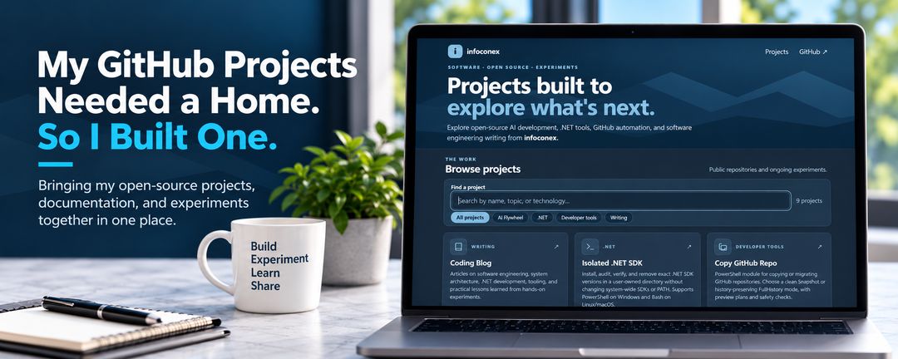

Over the years, I've created a number of software projects. Some started because I needed to solve a problem. Others came from experimenting with a technology or wondering whether there was a better way to accomplish something.

Most of them ended up on GitHub, which is where I wanted the code to live.

But having code publicly available and making it easy for someone to discover and understand are two different things.

A GitHub profile is a good place to find repositories if you already know what you're looking for. It isn't necessarily the best way to explain why a project exists, what problem it solves, or how it relates to other work.

I wanted a better way to bring those things together.

So I built a home for my public projects:

**[Explore the project site](https://projects.infoconex.com/)**

## Why Another Website?

I already have [a coding blog](https://coding.infoconex.com/) where I've been writing about software development for years. More recently, I've been documenting experiments with .NET, AI-assisted development, and developer tooling.

The articles capture the problems I was trying to solve and what I learned along the way. GitHub holds the implementations.

What I was missing was an easy way to explore the projects themselves.

Someone reading about testing a new .NET SDK might be interested in other development tools I've built. Someone finding a repository might want more context before digging through the source code.

I didn't want to turn my blog into a software catalog or duplicate all my README files. I wanted a simple entry point between the two.

## A Few of the Projects

The [project site](https://projects.infoconex.com/) includes individual pages for the tools and experiments, with links back to their GitHub repositories.

A few examples show the range of work.

### Isolated .NET SDK

While evaluating prerelease versions of .NET, I wanted to install and test exact SDK versions without changing the SDKs I use every day.

That became [Isolated .NET SDK](https://projects.infoconex.com/isolated-dotnet-sdk/), a tool for managing SDK installations in a user-owned directory. I also wrote about how it evolved from an installation helper into a tool that can [list, verify, and audit installed SDKs](/post/2026/10/21/managing-dotnet-sdks-installation-was-just-the-beginning).

### Copy GitHub Repo

Copying a repository sounds straightforward until you need to decide what should happen to its history and what should be included in the destination.

[Copy GitHub Repo](https://copy-github-repo.infoconex.com/) grew out of that problem. It supports a clean snapshot or a history-preserving copy, with a way to preview the intended operation before making changes.

### AI Flywheel

I've also been exploring how AI-assisted development can move beyond one-off prompts toward workflows that are more structured and repeatable.

The [AI Flywheel projects](https://github.com/infoconex/ai-flywheel-framework) reflect some of that work. They're experiments in how to organize the process, not a claim that every development task needs more agents or more automation.

These are only examples. The purpose of the site is to make it easier to discover the rest without knowing the repository names first.

## Building the Site Without Adding Much Infrastructure

Since the code was already on GitHub, [GitHub Pages](https://docs.github.com/en/pages) was a natural fit for hosting a static website.

I wanted the site to be simple to operate. In particular, I didn't want to manually edit several pages every time I added a project or changed its description.

The solution was to maintain a central `projects.json` catalog. That catalog contains the information used to build the directory and individual project pages.

From there, the publishing workflow can generate the pages and supporting metadata, validate the output, and deploy through GitHub Actions.

The design also addresses a problem I've been paying more attention to on my blog: discoverability.

Individual project pages have descriptive content and metadata so visitors and search engines can understand what each project is about. The pages aren't dependent on client-side JavaScript just to expose their basic content.

None of this requires a complicated application stack. That's part of the appeal. A catalog, static pages, and an automated deployment are enough for the job.

## Making the Code Easier to Find Is Only Half the Point

I don't expect every project to interest every visitor. Some are narrow tools for a specific need. Others are explorations that may change as I learn more.

But I'd like someone facing a similar problem to be able to find the work, understand why I approached it the way I did, and decide whether it's useful.

I've been thinking about how developers discover technical material, including through traditional search and AI-assisted answers. Clear titles, individual pages, and useful descriptions don't guarantee discovery, but they're a better starting point than assuming everyone will browse a list of repository names.

They also encourage me to explain each project's purpose, rather than assuming the code can speak entirely for itself.

## The Blog and the Projects Belong Together

My preferred way to understand a technology is to work with it.

I might begin with a question, put together a proof of concept, test an assumption, and find out that the real problem is different from the one I started with. Sometimes that leads to a useful tool. Sometimes the experiment itself is the useful result.

When I write about the experience, it belongs on the [coding blog](https://coding.infoconex.com/). When there's code worth sharing, it belongs on GitHub.

The new site connects those two parts of the work.

**The blog explains what I'm learning and why. The project site gives people access to what I'm building.**

An article can cover the tradeoffs and findings. The project page can help someone get to the implementation, documentation, and source.

## What's Next?

I don't expect the site to be finished. As I build new tools and revisit older ones, I'll keep adding to the collection.

Not every experiment needs to turn into a production-ready library. Sometimes it's enough to understand a problem better and share what happened.

But when there's something useful to share, I'd like it to be easy to find.

**[Browse the public projects](https://projects.infoconex.com/)**

**[Read the coding blog](https://coding.infoconex.com/)**
