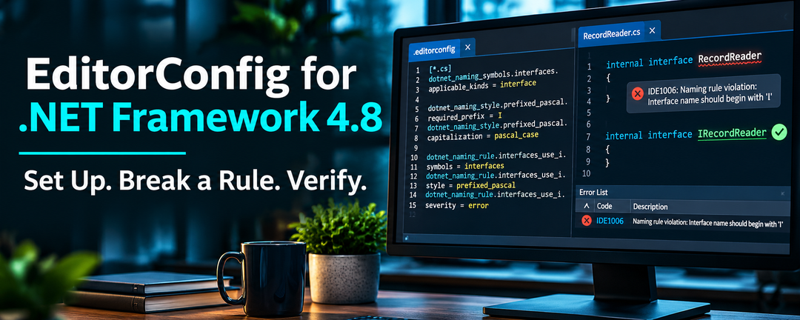

Coding conventions help maintain consistency across a codebase. But even when developers agree on how code should be written, their development environments may apply different preferences.

One developer uses tabs, another uses spaces. Naming conventions vary, and code reviews become cluttered with formatting changes rather than focusing on behavior.

An `.editorconfig` file helps by making code-style preferences part of the repository.

But before creating one, we should answer a more important question:

**What coding conventions do we want our project to follow?**

EditorConfig works with traditional .NET Framework 4.8 projects without requiring SDK-style conversion. You can define naming and formatting conventions in `.editorconfig`, then test them by deliberately introducing violations and checking the results in Visual Studio and `dotnet format`.

We'll use [RecordSift](https://github.com/infoconex/RecordSift){:target="_blank" rel="noopener noreferrer"}, a traditional .NET Framework 4.8 library, as our working example.

## Coding Standards vs. Code Style

Coding standards describe the broader engineering expectations adopted by a team. They may address naming, formatting, API design, security, architecture, and maintainability.

**Code style is a subset of those standards**, focused on how code is written and organized.

Examples include naming conventions, indentation, brace placement, and preferences for `var` versus explicit types.

EditorConfig can express many of these conventions. It can also configure diagnostics produced by code analyzers, but it doesn't replace every mechanism used to enforce coding standards.

### Our Decision for RecordSift

For RecordSift, we adopted Microsoft's published C# coding conventions and applicable .NET design guidelines.

Rather than inventing a comprehensive style guide, we use Microsoft's guidance as our foundation and document our project-specific decisions.

Our [C# coding standards](https://github.com/infoconex/RecordSift/blob/main/docs/engineering/csharp-style.md){:target="_blank" rel="noopener noreferrer"} include conventions such as:

| Code element | Convention | Example |
|---|---|---|
| Classes and methods | PascalCase | `ImportRecords` |
| Interfaces | `I` + PascalCase | `IRecordReader` |
| Local variables | camelCase | `recordCount` |
| Private instance fields | `_camelCase` | `_recordReader` |
| Constants | PascalCase | `MaxRecordCount` |

We also preserve compatibility with C# 7.3. For example, we use block-scoped namespaces rather than newer file-scoped syntax.

Useful Microsoft references include:

- [C# Coding Conventions](https://learn.microsoft.com/en-us/dotnet/csharp/fundamentals/coding-style/coding-conventions){:target="_blank" rel="noopener noreferrer"}
- [C# Identifier Naming Guidelines](https://learn.microsoft.com/en-us/dotnet/csharp/fundamentals/coding-style/identifier-names){:target="_blank" rel="noopener noreferrer"}
- [.NET Code Analysis Overview](https://learn.microsoft.com/en-us/dotnet/fundamentals/code-analysis/overview){:target="_blank" rel="noopener noreferrer"}

**Our standards describe what we expect. EditorConfig expresses the conventions supported by our development tools.**

## Does EditorConfig Work with .NET Framework?

Yes. EditorConfig works with traditional .NET Framework applications without requiring changes to their target framework or project format.

EditorConfig is a configuration-file format supported by many development environments, including Visual Studio.

It can define indentation, line endings, character encoding, naming conventions, and code-style preferences.

Because the configuration is stored in the repository, contributors can share settings without manually configuring every development environment.

Adding an EditorConfig file doesn't automatically reformat existing code. Visual Studio can apply formatting through commands such as Format Document or Code Cleanup, but those changes should be evaluated separately.

Defining a rule also doesn't guarantee enforcement. Detection depends on the editor, available analyzers, and verification tooling.

## Creating or Evaluating an EditorConfig File

First, check whether your repository already contains an `.editorconfig` file.

Configuration files can exist at the repository root, in subdirectories, or in parent directories. More local settings may override inherited values.

You can create or evaluate an EditorConfig file in several ways.

### Create Settings with Visual Studio

Visual Studio can generate EditorConfig settings from your existing code-style preferences.

In Visual Studio 2022, navigate to:

**Tools → Options → Text Editor → C# → Code Style → General**

Select **Generate .editorconfig file from settings**.

Alternatively, use **Add New Item** to create an EditorConfig file.

This provides a convenient starting point when you've already selected preferences in Visual Studio.

### Discover Conventions with IntelliCode

Microsoft also documents an IntelliCode feature that can examine existing code and infer coding conventions.

Where supported, right-click in Solution Explorer and select:

**Add → New EditorConfig (IntelliCode)**

Rather than using personal IDE preferences, IntelliCode generates configuration based on patterns found in existing source code.

This can be useful when inheriting an application whose coding conventions were never formally documented.

Feature availability depends on your Visual Studio installation and IntelliCode support. See Microsoft's [Define consistent coding styles with EditorConfig](https://learn.microsoft.com/en-us/visualstudio/ide/create-portable-custom-editor-options?view=vs-2022){:target="_blank" rel="noopener noreferrer"} for details.

### Explore Conventions with AI

AI-assisted development tools can help identify existing conventions, compare them with published guidance, and suggest configuration improvements.

For example, you could ask an AI assistant with repository access:

> Examine the project's C# source files and existing `.editorconfig`. Identify the naming and formatting conventions currently used. Compare them with Microsoft's published guidelines and our supported C# language version. Recommend applicable EditorConfig settings, identify conflicts, and suggest how to verify each recommendation. Do not modify any files.

The instruction not to modify files keeps the initial exercise focused on discovery and recommendations rather than introducing unreviewed changes.

### Configure Rules Manually

You can also edit `.editorconfig` directly using Microsoft's documentation:

- [.NET Code-Style Rule Options](https://learn.microsoft.com/en-us/dotnet/fundamentals/code-analysis/code-style-rule-options){:target="_blank" rel="noopener noreferrer"}
- [Code-Style Naming Rules](https://learn.microsoft.com/en-us/dotnet/fundamentals/code-analysis/style-rules/naming-rules){:target="_blank" rel="noopener noreferrer"}

These approaches can be combined.

For an undocumented application, IntelliCode or AI-assisted discovery can help establish what conventions already exist. If standards have already been selected, start with those standards and Microsoft's documented settings.

**Whichever approach you choose, review the resulting configuration.** Existing code may contain inconsistent conventions, and generated recommendations may not suit your project's language version or development tools.

There's no need to include every available rule.

## Understanding How a Naming Rule Works

Let's examine a rule from RecordSift.

Our standard requires interface names to begin with a capital `I`, followed by PascalCase.

For example:

```csharp
// Violates our standard
internal interface RecordReader
{
}

// Follows our standard
internal interface IRecordReader
{
}
```

How does EditorConfig distinguish these declarations?

Microsoft's naming configuration uses three components: a symbol group, a naming style, and a rule connecting them.

### 1. Identify the Symbols

First, define which code elements are affected.

```ini
dotnet_naming_symbols.interfaces.applicable_kinds = interface
```

This creates a symbol group named `interfaces` that applies to interface declarations.

Roslyn understands C# syntax, allowing it to distinguish interfaces from classes, methods, and other declarations.

### 2. Define the Naming Style

Next, define how the identifiers should be named.

```ini
dotnet_naming_style.prefixed_pascal.required_prefix = I
dotnet_naming_style.prefixed_pascal.capitalization = pascal_case
```

This defines a style named `prefixed_pascal` requiring an `I` prefix and PascalCase capitalization.

### 3. Connect the Symbols and Style

Finally, create the rule.

```ini
dotnet_naming_rule.interfaces_use_i.symbols = interfaces
dotnet_naming_rule.interfaces_use_i.style = prefixed_pascal
dotnet_naming_rule.interfaces_use_i.severity = error
```

This tells the analyzer to check interface names against the specified naming style and report violations at error severity in the IDE.

The identifiers `interfaces`, `prefixed_pascal`, and `interfaces_use_i` are names we've chosen to connect these definitions.

### Putting the Configuration Together

Here's a minimal example combining RecordSift's formatting preferences, interface-naming convention, and preference for block-scoped namespaces:

```ini
root = true

[*.{cs,csx}]
# Formatting
indent_style = space
indent_size = 4
end_of_line = lf

# Interface symbols
dotnet_naming_symbols.interfaces.applicable_kinds = interface

# Required naming style
dotnet_naming_style.prefixed_pascal.required_prefix = I
dotnet_naming_style.prefixed_pascal.capitalization = pascal_case

# Interface naming rule
dotnet_naming_rule.interfaces_use_i.symbols = interfaces
dotnet_naming_rule.interfaces_use_i.style = prefixed_pascal
dotnet_naming_rule.interfaces_use_i.severity = error

# Diagnostic severity
dotnet_diagnostic.IDE1006.severity = error

# Prefer block-scoped namespaces (file-scoped requires C# 10)
csharp_style_namespace_declarations = block_scoped:suggestion
```

The `root = true` setting stops EditorConfig from searching for configuration in parent directories. The `[*.{cs,csx}]` section applies these settings to C# source and script files.

The formatting settings establish our preference for four-space indentation and LF line endings.

Line endings also depend on Git configuration. On Windows, settings such as `core.autocrlf` can affect the files checked out into the working directory. When choosing LF or CRLF, align EditorConfig with your repository's `.gitattributes` rules and Git configuration to avoid inconsistent results.

The namespace setting guides supported editor suggestions and refactorings. It doesn't enforce C# language compatibility: RecordSift's project configuration specifies `LangVersion` 7.3, which prevents unsupported C# syntax from compiling.

Notice the `:suggestion` severity. Our CI naming check selects error-level `IDE1006` diagnostics; it doesn't enforce this namespace preference.

RecordSift's actual `.editorconfig` contains additional naming rules, formatting preferences, and file-specific sections.

When naming rules overlap, Visual Studio 2019 and later select applicable rules by specificity rather than their order in the file. A more specific rule may be needed to resolve competing conventions. Earlier Visual Studio versions used declaration order.

### Why Are There Two Severity Settings?

Our naming rule specifies:

```ini
dotnet_naming_rule.interfaces_use_i.severity = error
```

This controls how the rule is reported in supported IDEs.

We also specify:

```ini
dotnet_diagnostic.IDE1006.severity = error
```

This configures the severity of the Roslyn naming diagnostic.

Because `IDE1006` is shared by naming rules, this setting affects naming violations more broadly—not just interface names.

We selected error severity because we want automated naming verification to reject violations. Other teams may choose warnings or suggestions depending on their enforcement policy.

Setting diagnostic severity makes violations eligible for enforcement through compatible analyzer and build tooling. It doesn't, by itself, enable analyzers during compilation.

You can examine our complete configuration in [RecordSift's `.editorconfig`](https://github.com/infoconex/RecordSift/blob/main/.editorconfig){:target="_blank" rel="noopener noreferrer"}.

## Verify That Your Rules Actually Work

Creating a rule doesn't prove that your development tools recognize or enforce it.

One of the simplest ways to verify a rule is to **intentionally violate it**.

### First, Verify the Naming Convention

In a disposable working branch, add a temporary declaration to an existing C# source file included in your project:

```csharp
internal interface RecordReader
{
}
```

We're deliberately omitting the required `I` prefix.

Using a project-included file matters for traditional .NET Framework projects, which often explicitly list their compiled source files.

Open the file in Visual Studio. With the appropriate analyzer active, the editor should report `IDE1006`.

Rename the interface:

```csharp
internal interface IRecordReader
{
}
```

Confirm that the diagnostic disappears.

We've demonstrated that our tooling recognizes the interface-naming convention.

But have we proved that it loaded our custom EditorConfig rule?

Not necessarily.

### Next, Verify That EditorConfig Controls the Rule

Roslyn already recognizes several default naming conventions, including the `I` prefix for interfaces.

That means detecting `RecordReader` as a violation doesn't independently prove that our custom rule was applied.

We can investigate this by temporarily changing the required prefix.

In our working copy of `.editorconfig`, change:

```ini
dotnet_naming_style.prefixed_pascal.required_prefix = I
```

To:

```ini
dotnet_naming_style.prefixed_pascal.required_prefix = X
```

Now test the following declarations, one at a time.

| Interface | Expected result with `X` required |
|---|---|
| `IRecordReader` | Naming violation |
| `XRecordReader` | No interface-naming violation |

If the diagnostic follows our temporary `X`-prefix convention, we have stronger evidence that the custom configuration is being applied rather than only Roslyn's default behavior.

Restore the original `I` prefix afterward and confirm the expected behavior returns.

**The purpose of this experiment isn't to adopt a different convention. It's to prove that changing the configuration changes the analyzer's behavior.**

If the results don't match expectations, check the effective configuration before assuming the analyzer is defective.

### Troubleshooting Unexpected Results

Visual Studio discovers EditorConfig files by searching from the source file's directory upward until it reaches a file containing `root = true` or the filesystem root.

Check that the intended `.editorconfig` applies to the source file, that its section matches the filename, and that another section or more local file doesn't override the setting.

In Visual Studio 2022, the status bar can indicate when EditorConfig settings override your personal preferences. This is a useful first check, although it doesn't prove that every individual rule is active.

If the diagnostic doesn't update after changing the configuration, reload the affected source file and check the Error List.

See Microsoft's [EditorConfig guidance](https://learn.microsoft.com/en-us/visualstudio/ide/create-portable-custom-editor-options?view=vs-2022){:target="_blank" rel="noopener noreferrer"} for additional details.

### Verify EditorConfig Naming Rules in CI with `dotnet format`

If your team expects naming conventions to be enforced in CI, verify that separately.

RecordSift uses the .NET SDK's `dotnet format` command to check selected naming conventions.

After restoring the solution's dependencies, our Windows CI workflow runs:

```powershell
dotnet format style RecordSift.sln --no-restore --verify-no-changes --diagnostics IDE1006 --severity error --verbosity normal
```

The command checks whether `dotnet format` would make corrections for applicable `IDE1006` diagnostics configured at error severity.

The important options are:

- `--diagnostics IDE1006` limits the check to that diagnostic.
- `--severity error` selects the minimum diagnostic severity; it doesn't change the configured severity.
- `--verify-no-changes` prevents modifications and returns a nonzero exit code when applicable corrections would be made.
- `--no-restore` skips dependency restoration.

This check depends on the relevant analyzer and code fix being available. It isn't a guarantee that every possible naming violation will be detected.

Run the command with an intentional violation present. Inspect the reported diagnostics and confirm the expected failure.

Correct the violation and run it again. It should pass, assuming no other applicable violations remain.

Remove the temporary declaration and restore the original configuration when finished.

**Don't rely on the exit code alone. Verify that the specific violation you introduced was actually detected.**

### What About Formatting Rules?

The naming check above doesn't verify indentation, line endings, or other whitespace conventions.

The .NET SDK also provides a separate command for checking whitespace formatting:

```powershell
dotnet format whitespace RecordSift.sln --no-restore --verify-no-changes
```

This checks whether the formatter would make whitespace-related changes based on the applicable settings.

As with naming rules, deliberately introduce a formatting violation, confirm that verification fails, then correct it and confirm that the check passes.

Before enabling this check in CI, verify how it handles line endings in your environment. For example, a Windows checkout that converts LF files to CRLF may cause formatting violations across many files.

This is an additional verification option, not a command currently enforced by RecordSift's CI workflow. We would validate it against the project's existing formatting before introducing it as a required gate.

### Tooling Requirements for Traditional Projects

`dotnet format` is available with the .NET 6 SDK and later.

The SDK used for development tooling is separate from the framework targeted by your application. A .NET Framework 4.8 library can be analyzed using a newer SDK without changing its target framework.

However, the SDK must be able to load the solution. Traditional projects may require compatible Windows build tooling, reference assemblies, and restored dependencies.

RecordSift uses Visual Studio MSBuild for compilation and the installed .NET SDK for its targeted naming check.

For reproducibility, our Windows CI workflow records the SDK version used during analysis. For example, the [successful November 8, 2026 run](https://github.com/infoconex/RecordSift/actions/runs/42531816187){:target="_blank" rel="noopener noreferrer"} recorded .NET SDK `10.0.403`.

That version is evidence of a verified execution, not a required SDK version. The workflow currently uses the SDK installed on the Windows runner rather than pinning a specific release.

Running code-style analyzers during ordinary compilation is a separate configuration decision. Microsoft documents properties such as `EnforceCodeStyleInBuild`, but the required analyzer assemblies and project integration depend on the project format and tooling.

For traditional projects, C# code-style analyzers have also been distributed through `Microsoft.CodeAnalysis.CSharp.CodeStyle`. The separate `Microsoft.CodeAnalysis.NetAnalyzers` package provides .NET code-quality analysis.

We haven't adopted those packages for RecordSift's production projects. Their integration and value warrant a separate evaluation rather than being prerequisites for our existing targeted verification.

See Microsoft's [Code Analysis Overview](https://learn.microsoft.com/en-us/dotnet/fundamentals/code-analysis/overview){:target="_blank" rel="noopener noreferrer"} for additional guidance.

### When Verification Reveals a Gap

During RecordSift's development, we found that Roslyn's naming analyzer didn't consistently reject certain uppercase, underscore-separated constant identifiers.

For example, our convention requires:

```csharp
// Violates our naming convention
private const int MAX_RECORD_COUNT = 100;

// Follows our naming convention
private const int MaxRecordCount = 100;
```

The problem wasn't the constant's value. It was the identifier's naming style.

Because our verification didn't consistently detect this pattern, we added a focused supplemental check using [`scripts/validate_constant_names.py`](https://github.com/infoconex/RecordSift/blob/main/scripts/validate_constant_names.py){:target="_blank" rel="noopener noreferrer"}.

The script runs in our documentation-validation CI workflow, including positive and negative examples. It supplements Roslyn rather than replacing semantic analysis.

Our investigation and supporting evidence are documented in [ADR 0012 — Enforce Microsoft C# Naming](https://github.com/infoconex/RecordSift/blob/main/docs/engineering/decisions/0012-microsoft-csharp-naming-ci.md){:target="_blank" rel="noopener noreferrer"}.

This is why we recommend deliberately violating conventions that matter to your enforcement policy.

## Evaluating an Existing Configuration

If your repository already has an `.editorconfig`, don't replace it simply because you're modernizing the application.

Compare its settings with your documented coding standards and verify the rules you intend to rely on.

Some requirements belong elsewhere. For example, RecordSift generates XML documentation and treats compiler diagnostic `CS1591` as an error when public members lack required documentation.

This is compiler-based enforcement, not an EditorConfig code-style rule. The compiler must be configured to generate XML documentation—through `DocumentationFile` in RecordSift's traditional projects, or `GenerateDocumentationFile` in projects supporting that property. EditorConfig can configure the diagnostic's severity but doesn't enable documentation generation.

Generated code also deserves consideration. .NET analyzers commonly recognize files such as `*.Designer.cs` as generated code. For other generated-file patterns, you can use `generated_code = true` in an appropriate EditorConfig section so supporting analyzers treat those files as generated.

If your existing configuration supports your standards and your verification confirms its behavior, there may be nothing to improve.

## Frequently Asked Questions

### Does EditorConfig work with .NET Framework 4.8?

Yes. Visual Studio supports EditorConfig for traditional .NET Framework 4.8 projects, including naming conventions, formatting preferences, and analyzer settings. The available diagnostics and enforcement mechanisms depend on your development tooling.

### Do I need to convert my project to SDK-style to use EditorConfig?

No. EditorConfig can be adopted without changing your project's format, target framework, or C# language version. Some automated analysis tools may require additional configuration to load and analyze traditional projects.

### Why isn't Visual Studio reporting an IDE1006 naming violation?

Check that the source file is included in the project, that the correct EditorConfig section applies, and that the naming analyzer is available and enabled. Also verify the rule's severity and look for settings inherited from other EditorConfig files.

### How can I verify EditorConfig rules using `dotnet format`?

Use `dotnet format style` with `--verify-no-changes` to check applicable code-style fixes without modifying source files. Introduce a deliberate violation, confirm that the expected diagnostic causes verification to fail, then correct it and confirm the check passes.

## Final Thoughts

EditorConfig offers a practical way to share coding conventions across a development team, including teams maintaining traditional .NET Framework applications.

For RecordSift, we adopted Microsoft's C# conventions, documented our project-specific requirements, configured EditorConfig, and verified selected naming rules through automated tooling.

We accomplished this without changing our application's target framework or project format.

**Choose your conventions. Configure the rules. Intentionally violate them. Verify the results.**
