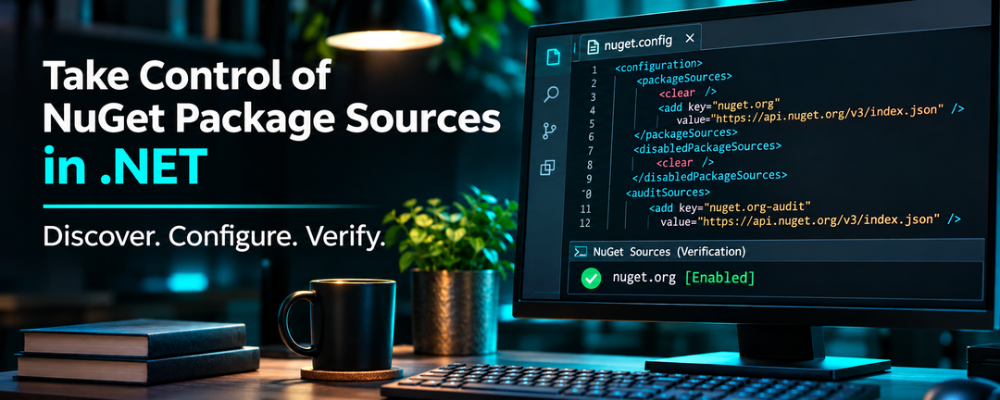

Your .NET application restores its dependencies successfully. Visual Studio builds the solution, tests pass, and everything seems to work.

But where are those packages coming from? Would another developer—or your CI pipeline—use the same sources?

**A repository-level `nuget.config` lets you declare which package feeds your application should use instead of relying on whatever is configured on individual machines.** This works with traditional .NET Framework projects; you don't need to convert them to SDK-style or upgrade their target framework.

We'll discover the configuration NuGet is using, make an explicit decision about sources, and verify that the tools actually honor it. We'll use [RecordSift](https://github.com/infoconex/RecordSift), a .NET Framework 4.8 application, as an example.

## A successful restore doesn't prove your sources are controlled

Imagine two developers cloning the same repository. One has only nuget.org configured. The other also has a company feed and an old local package directory. Both run a restore successfully.

**That does not prove they restored from the same configured sources.** NuGet combines settings from machine-, user-, and directory-level configuration files. More specific settings take precedence; entries in collections such as package sources are inherited unless cleared.

The goal isn't merely to make restore succeed. It's to make source policy understandable, intentional, and testable—much like the coding conventions established in the earlier [EditorConfig article](/post/2026/11/09/editorconfig-dotnet-framework-4-8-verify-code-style).

## Step 1: Discover the configuration you're inheriting

Before changing anything, identify the configuration files NuGet considers. The .NET CLI commands in this section run on Windows, macOS, and Linux.

From your solution directory, run:

```shell
dotnet nuget config paths
```

**Illustrative output:**

**Windows**

```text
C:\Users\<username>\projects\myapp\nuget.config
```

**Linux**

```text
/home/<username>/projects/myapp/nuget.config
```

**macOS**

```text
/Users/<username>/projects/myapp/nuget.config
```

The command requires .NET SDK 8.0.2xx or later.

**Inspect every file it lists** to identify where an unexpected setting originated, such as a user-level configuration, a parent directory, or your repository.

Next, inspect the effective package sources:

```shell
dotnet nuget list source
```

**Illustrative output:**

```text
Registered Sources:
  1.  nuget.org [Enabled]
      https://api.nuget.org/v3/index.json
  2.  CompanyFeed [Enabled]
      https://packages.example.com/nuget/v3/index.json
```

This example shows two enabled feeds; `CompanyFeed` is hypothetical. If you expected only nuget.org, investigate which configuration introduced the additional source. The source listing does not identify its originating file, so refer to the configuration paths above.

See Microsoft's [NuGet configuration documentation](https://learn.microsoft.com/en-us/nuget/consume-packages/configuring-nuget-behavior/) for the configuration hierarchy. You can also inspect package sources in Visual Studio under **Tools → Options → NuGet Package Manager → Package Sources**. Changing user settings, however, is not necessarily a repository change.

### Compare inherited configuration with one specific file

If your repository contains `nuget.config`, you can inspect its settings independently:

```shell
dotnet nuget list source --configfile ./nuget.config
```

**Illustrative output:**

```text
Registered Sources:
  1.  nuget.org [Enabled]
      https://api.nuget.org/v3/index.json
```

Without `--configfile`, NuGet evaluates the applicable configuration hierarchy. With it, NuGet uses only the specified file. **Don't use `--configfile` when testing whether normal configuration inheritance works.**

### Does capitalization matter?

The examples use lowercase `nuget.config`. NuGet recognizes several filename spellings during automatic discovery on case-sensitive file systems; its [commit-pinned implementation](https://github.com/NuGet/NuGet.Client/blob/59daae5c6fb0c9655e00fd70169b905463c29147/src/NuGet.Core/NuGet.Configuration/Settings/Settings.cs#L24-L43) explicitly prefers lowercase.

When using `--configfile`, supply the filename's actual spelling.

## Step 2: Declare an explicit package-source policy

RecordSift's [original application baseline](https://github.com/infoconex/RecordSift/commit/3627a62260437db0bde83c5c7d3be56caee8af95) already declared nuget.org as its package source:

```xml
<packageSources>
  <clear />
  <add key="nuget.org"
       value="https://api.nuget.org/v3/index.json" />
</packageSources>
```

The `<add>` element names an approved feed. The `<clear />` element removes inherited entries from this collection, so an unexpected machine- or user-level feed doesn't silently join the list.

### A second collection can still disable the source

NuGet tracks disabled sources separately. Suppose a developer's user-level configuration contains:

```xml
<disabledPackageSources>
  <add key="nuget.org" value="true" />
</disabledPackageSources>
```

Even though RecordSift's `packageSources` section explicitly includes nuget.org, this inherited entry can disable it. **Clearing `packageSources` doesn't clear `disabledPackageSources`.**

If the approved policy is that the repository's declared nuget.org source should be enabled, add:

```xml
<disabledPackageSources>
  <clear />
</disabledPackageSources>
```

### Respect organizational source restrictions

This is a deliberate policy decision, not a rule to copy into every project. Clearing inherited feeds can remove a company-mandated internal source; clearing disabled-source entries can also override a company decision to disable public feeds.

If your organization requires packages to come through an internal repository, configure *that* policy instead. `nuget.config` by itself isn't a security boundary: enforced network restrictions may also be required.

### Keep vulnerability auditing separate

RecordSift also declares an audit source:

```xml
<auditSources>
  <clear />
  <add key="nuget.org-audit"
       value="https://api.nuget.org/v3/index.json" />
</auditSources>
```

`packageSources` controls where packages can be obtained; `auditSources` controls where NuGet gets information about known vulnerabilities. They can point to different services.

NuGet Audit supports traditional `packages.config` projects from NuGet 6.10, and separate `auditSources` from NuGet 6.12. If `auditSources` is absent or empty, NuGet falls back to package sources for advisory information. Explicitly specifying both prevents that fallback from becoming an accidental policy if package feeds change later. See [Microsoft's NuGet Audit documentation](https://learn.microsoft.com/en-us/nuget/concepts/auditing-packages).

## Step 3: Verify inheritance with positive and negative controls

Source inheritance was tested on a disposable Windows GitHub Actions runner using parent and child configuration files. This diagram uses the repository's current filename:

```text
NuGetTest/
├── nuget.config
└── Application/
    └── nuget.config
```

The four results below came from the original EXP-044 research run. A subsequent CI run verified the disabled-source behavior and package-restore controls.

The **parent** configuration introduced an extra feed and disabled nuget.org:

```xml
<configuration>
  <packageSources>
    <add key="test-feed" value="C:\NuGetTestFeed" />
  </packageSources>
  <disabledPackageSources>
    <add key="nuget.org" value="true" />
  </disabledPackageSources>
</configuration>
```

The **child** configuration—the positive control—declared nuget.org and cleared both inherited collections:

```xml
<configuration>
  <packageSources>
    <clear />
    <add key="nuget.org"
         value="https://api.nuget.org/v3/index.json" />
  </packageSources>
  <disabledPackageSources>
    <clear />
  </disabledPackageSources>
</configuration>
```

From the child directory, the experiment ran:

```shell
dotnet nuget list source
```

Each test changed one configuration setting before repeating the command.

These are the **observed results from the original EXP-044 research run**:

| Test | Actual nuget.org status | Other inherited source |
|---|---|---|
| Both collections cleared | Enabled | `test-feed` absent |
| Remove `packageSources` clear | Enabled | `test-feed` present |
| Remove entire `disabledPackageSources` section | Disabled | `test-feed` absent |
| Restore both clear elements | Enabled | `test-feed` absent |

With both collections cleared, the command returned:

```text
Registered Sources:
  1.  nuget.org [Enabled]
      https://api.nuget.org/v3/index.json
```

Removing the package-source `<clear />` exposed both the configured `test-feed` and the runner's inherited **Microsoft Visual Studio Offline Packages** source:

```text
Registered Sources:
  1.  nuget.org [Enabled]
      https://api.nuget.org/v3/index.json
  2.  test-feed [Enabled]
      C:\NuGetTestFeed
  3.  Microsoft Visual Studio Offline Packages [Enabled]
      C:\Program Files (x86)\Microsoft SDKs\NuGetPackages\
```

Removing the disabled-source section instead produced:

```text
Registered Sources:
  1.  nuget.org [Disabled]
      https://api.nuget.org/v3/index.json
```

Restoring both clear elements returned nuget.org to `[Enabled]`. All four comparisons produced the expected results. Your machine may list other inherited sources when the package-source clearing rule is removed.

### Verified environment

| Component | Verified version |
|---|---|
| GitHub Actions runner | `windows-2022` |
| .NET SDK | `10.0.403` |
| NuGet CLI | `7.9.0.83` |
| PowerShell | `7.6.9` |

The experiment ran on Windows, although the source-listing command itself is cross-platform.

The original outputs are retained in [EXP-044](https://github.com/infoconex/dotnet-modernization/blob/47866780f9a629dd56bf6ee3a4e175e247c4f480/projects/recordsift/evaluations/2026-11-pre-sdk/experiments/EXP-044-nuget-config-source-inheritance.md) and its [successful research run](https://github.com/infoconex/RecordSift/actions/runs/42737924517). 
The [subsequent CI run](https://github.com/infoconex/RecordSift/actions/runs/42775223915) also passed.

## Step 4: Test an actual restore—not just the source listing

`dotnet nuget list source` verifies effective configuration, but it doesn't prove that package acquisition succeeds or fails because of that configuration.

A second experiment tested package restoration using a disposable `packages.config` containing **NUnit 3.14.0**, a dependency already used by RecordSift. The experiment used the standalone `nuget.exe` CLI on Windows; it was not run on macOS or Linux:

```xml
<packages>
  <package id="NUnit" version="3.14.0" targetFramework="net48" />
</packages>
```

From the disposable `Application` directory, the verification script ran the same command twice: once with the child's `disabledPackageSources` clearing rule removed, and once with it present. In each run, `$destination` was a different, initially empty temporary package directory.

**Command used for both restore tests:**

```powershell
nuget restore .\packages.config -NonInteractive -PackagesDirectory $destination -DirectDownload -NoHttpCache -Verbosity detailed
```

There was no `-ConfigFile` or `-Source` override. The direct-download and no-HTTP-cache options limited cache interference.

The two controls produced these **observed results**:

| Restore condition | Exit code | NUnit installed? |
|---|---:|---|
| Inherited nuget.org disabled; no child disabled-source clear | `1` | No |
| Same setup, child clears disabled sources | `0` | Yes |

The failing restore log explicitly reports:

```text
Restoring NuGet package NUnit.3.14.0.
Unable to find version '3.14.0' of package 'NUnit'.
```

The successful control instead shows NuGet downloading `nunit.3.14.0.nupkg` from nuget.org, installing it, and recording nuget.org under *Feeds used*. The paired source listings, the package-not-found message, and the successful retry with the clearing rule establish the observed difference. Full logs, including NuGet's cleanup diagnostics, are retained with the workflow artifact.

The same positive and negative controls passed again. The [successful verification workflow](https://github.com/infoconex/RecordSift/actions/runs/42775223915) retains both [complete restore logs and results](https://github.com/infoconex/RecordSift/actions/runs/42775223915/artifacts/13743955821).

### Verify the application solution

A separate test restored the RecordSift solution without `-ConfigFile`, using a fresh package directory.

**Command used to restore the solution:**

```powershell
nuget restore .\RecordSift.sln -NonInteractive -PackagesDirectory $packagesPath -Verbosity detailed
```

The verification script assigned `$packagesPath` a fresh temporary directory.

**Observed results:**

| Configuration | Effective source | Restore result |
|---|---|---|
| Original two-section configuration | nuget.org enabled | Exit `0` |
| Updated three-section configuration | nuget.org enabled | Exit `0` |

Both solution restores succeeded without an explicit configuration-file override.

**These solution restores confirm that both checked-in configurations work on the tested clean Windows runners. They do not exercise an inherited disabled-source setting. Only the controlled NUnit restore demonstrates the effect of the fix on package acquisition.**

## Step 5: Preserve a reviewable before-and-after case study

The restore experiments justified one **behavioral change**: add a `disabledPackageSources` clearing section while retaining the existing package and audit sources.

A separate consistency change standardized the repository filename as `nuget.config` and updated its references. It was not an experimental finding.

The complete case-study configuration is:

```xml
<?xml version="1.0" encoding="utf-8"?>
<configuration>
  <packageSources>
    <clear />
    <add key="nuget.org" value="https://api.nuget.org/v3/index.json" />
  </packageSources>
  <disabledPackageSources>
    <clear />
  </disabledPackageSources>
  <auditSources>
    <clear />
    <add key="nuget.org-audit" value="https://api.nuget.org/v3/index.json" />
  </auditSources>
</configuration>
```

For a reproducible comparison, see the [original application baseline commit](https://github.com/infoconex/RecordSift/commit/3627a62260437db0bde83c5c7d3be56caee8af95) and the [merged `nuget.config` at a fixed commit](https://github.com/infoconex/RecordSift/blob/d91557d9551cbde9f4c220ce8f68a014e3f28164/nuget.config). The accompanying [commit-pinned PowerShell verification script](https://github.com/infoconex/RecordSift/blob/d91557d9551cbde9f4c220ce8f68a014e3f28164/modernization/stages/nuget-config/scripts/verify.ps1) checks the configuration and its exact Git filename casing, and runs the same checks locally and in Windows CI.

[PR #268](https://github.com/infoconex/RecordSift/pull/268) merged into the `modernization/case-study` branch at [commit `d91557d`](https://github.com/infoconex/RecordSift/commit/d91557d9551cbde9f4c220ce8f68a014e3f28164), not `main`.

No dependencies, project formats, target frameworks, or application code were changed to demonstrate the improvement.

## What if you use private package feeds?

Applications using multiple feeds need additional care. An internal package identifier can also exist on a public feed, creating a **dependency confusion** risk if source eligibility isn't sufficiently constrained.

NuGet's [Package Source Mapping](https://learn.microsoft.com/en-us/nuget/consume-packages/package-source-mapping) can restrict package identifiers or patterns to eligible sources. Consider it when your approved policy involves multiple feeds.

Don't commit feed passwords or access tokens into `nuget.config`. Use appropriate credential providers or secure CI authentication instead.

## What this configuration doesn't guarantee

Controlling feeds is one piece of predictable package restoration, not a guarantee of fully reproducible or secure builds. Dependency versions, transitive resolution, caches, restore tools, command-line overrides, and security information all matter.

In traditional `packages.config` projects, NuGet doesn't support using `NoWarn` or `TreatWarningsAsErrors` to control audit-warning severity in the same way as PackageReference projects. RecordSift instead examines NuGet restore output for `NU1900` through `NU1905`. This detects those warnings, but a clean warning log alone doesn't prove that an advisory service was contacted.

## Frequently asked questions

### Should every .NET repository contain a nuget.config?

For independently maintained applications, source-controlled NuGet configuration is recommended when package-source policy should be explicit. A repository already governed by an intentional monorepo-level configuration may not need a duplicate file.

### Does nuget.config require SDK-style projects?

No. It also works with traditional .NET Framework projects. Individual commands and settings still require compatible NuGet tooling.

### Does nuget.config replace packages.config?

No. `packages.config` identifies packages and versions for traditional projects; `nuget.config` controls NuGet behavior, including sources.

### Does it make restores reproducible?

Not on its own. It makes an important part of the environment explicit and testable, but doesn't control every input to dependency resolution.

## Final thoughts

Modernization doesn't always begin with a framework upgrade.

For RecordSift, an inherited setting could override the intent of the existing repository configuration. The investigation reproduced the issue, confirmed the effective source listings, used an NUnit restore to verify package acquisition with and without the clearing rule, and preserved a small, reviewable change.

The XML change was simple. The verification made it meaningful.

**Understand the defaults. Take control of the configuration. Verify the behavior.**
