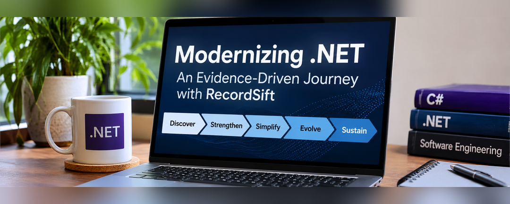

An application can run on the latest version of .NET and still be difficult to build, test, understand, or maintain.

Conversely, an application targeting .NET Framework 4.8 can adopt many modern engineering practices without changing its target framework.

**Modernization is not the same as upgrading .NET.**

That distinction is at the center of this series.

Using [RecordSift](https://github.com/infoconex/RecordSift), a working C# library built on .NET Framework 4.8, this series investigates how to understand an existing codebase, establish a reliable engineering baseline, evaluate modernization opportunities, and verify changes before adopting them.

The investigations will examine what works, what fails, and which improvements are not justified by the evidence.

The objective is not to reach a particular target framework. It is to make future engineering decisions, including runtime upgrades, more predictable and easier to validate.

## What Does Modernizing a .NET Application Mean?

Modernization improves an application's maintainability, reliability, security, development experience, and ability to evolve.

This series examines three related areas:

| Area | Examples | Objective |
| --- | --- | --- |
| Engineering practices | Coding standards, testing, dependency management, security, and continuous integration | Strengthen how software is developed and verified |
| Project infrastructure | MSBuild configuration, SDK selection, package management, build automation, and project formats | Simplify configuration and improve build reliability |
| Runtime and architecture | Target frameworks, dependency compatibility, architectural boundaries, and platform support | Enable new capabilities and supported environments |

These areas do not need to change together.

A team maintaining a .NET Framework application might improve automated testing and build configuration without changing its runtime. A team already using a modern .NET version and SDK-style projects might still need to address undocumented dependencies, unreliable tests, or architectural limitations.

The starting point is the application's actual engineering needs, not its framework version alone.

## Introducing RecordSift

[RecordSift](https://github.com/infoconex/RecordSift) is a reusable C# library for importing and processing structured data, including CSV and Excel files.

Its capabilities include data mapping, validation, diagnostics, and reporting.

The initial modernization baseline includes:

- .NET Framework 4.8 and C# 7.3.
- Traditional, non-SDK-style project files.
- Five production library projects and five NUnit test projects.
- Windows-based build and test automation.
- NuGet packaging and distribution.

RecordSift is distributed through NuGet, beginning with version 0.1.0.

### Why Use a Traditional .NET Framework Application?

RecordSift was deliberately constructed with a traditional .NET Framework foundation to support realistic engineering and modernization investigations. It is not recovered historical production software, and I do not want to present it that way.

Its project structure provides meaningful technical constraints without inventing a legacy production history.

Those constraints include MSBuild imports, framework targeting, dependency compatibility, automated testing, and package distribution.

RecordSift also provides observable behavior worth protecting.

For example, a modernization change should not unexpectedly alter how a CSV file is interpreted, how validation failures are reported, or how diagnostic information is exposed. Because other applications can consume RecordSift as a library, public API and package compatibility matter alongside internal correctness.

This creates several useful questions to investigate:

- Can project configuration be simplified without changing observable behavior?
- Which modern tools work with traditional projects?
- How can compatibility regressions be detected?
- When is SDK-style conversion justified?
- What evidence should support a runtime migration?

**RecordSift provides the constraints for the experiments, not the boundaries of what readers can learn.**

## An Evidence-Driven Approach to Modernization

Modernization recommendations are easy to find. Determining whether they are appropriate for a particular application requires investigation.

Five principles guide this series.

### 1. Understand Before Changing

Begin by examining the application's structure, behavior, dependencies, public interfaces, build requirements, and tests.

Documentation is useful, but it is not automatically authoritative. Source code, build outputs, automated tests, and observed behavior can reveal discrepancies between what an application is believed to do and what it actually does.

The purpose of discovery is to establish an accurate understanding of the application before making changes that could affect its behavior or compatibility.

### 2. Establish a Baseline

Before evaluating improvements, determine whether the existing solution can be restored, built, tested, and packaged under documented conditions.

The baseline should include known failures, environmental requirements, and compatibility constraints.

A repeatable build process does not necessarily produce byte-for-byte identical artifacts. Those outcomes should be distinguished and measured according to the evidence available.

Without a reliable baseline, it becomes difficult to determine whether a proposed change improves the application or introduces a regression.

### 3. Change One Thing at a Time

Each experiment should answer a specific engineering question.

Whenever practical, isolate changes to project configuration, dependencies, tooling, and runtime targeting rather than combining them into a single migration.

For example, evaluating shared MSBuild configuration should not require simultaneously converting project formats, replacing package management, and changing target frameworks.

Smaller changes make failures easier to diagnose and successful results easier to interpret.

### 4. Record What Worked and What Did Not

A modernization investigation should document unsuccessful experiments, unexpected results, and changes that turn out to be unnecessary, not just successful implementations.

A tool or configuration option may be technically compatible with an application without providing a meaningful benefit. Likewise, an unsuccessful experiment can reveal important constraints that influence future decisions.

Each investigation will document the intended improvement, evaluation approach, observed results, and rationale for adopting, deferring, or rejecting the proposed change.

**The goal is not to adopt every available modernization feature. It is to make informed engineering decisions based on demonstrated needs and verified results.**

### 5. Distinguish Evaluation, Implementation, and Release

This series uses three distinct states when describing modernization work.

| State | What it establishes |
| --- | --- |
| **Evaluated** | Research documents the experiment, observations, risks, and recommendation |
| **Implemented** | Source control and verification evidence establish what was incorporated into RecordSift |
| **Released** | A versioned NuGet artifact establishes what downstream consumers can obtain |

These states do not imply automatic progression.

An evaluated change may be rejected or deferred. An implemented change may not yet be released. A successful build does not necessarily establish compatibility with every downstream consumer.

The [dotnet-modernization research repository](https://github.com/infoconex/dotnet-modernization) records investigations and decisions, while the [RecordSift repository](https://github.com/infoconex/RecordSift) establishes what has been implemented.

Published NuGet packages provide a separate record of what consumers can install.

This distinction is especially important when evaluating changes to packaging, dependencies, project structure, and runtime compatibility.

## The .NET Modernization Roadmap

The RecordSift modernization journey is organized into five phases.

The phases describe an engineering progression rather than a strict publication sequence. Some supporting engineering practice articles are already published, while the RecordSift case study will develop through additional investigations and walkthroughs.

The roadmap identifies planned areas of investigation. It does not imply that every activity has been completed.

### Phase 1: Discover and Document

**Understand what exists.**

This phase examines the solution structure, projects, dependencies, target frameworks, public interfaces, build environment, automated tests, and known risks.

It also distinguishes verified facts from assumptions and identifies gaps in existing documentation.

**Expected outcome:** An evidence-backed technical inventory and compatibility baseline. A later assessment will identify and evaluate modernization opportunities.

**Articles and Walkthroughs**

- [Before You Upgrade .NET: Do You Know What Is Building It?](/post/2026/09/16/before-you-upgrade-dotnet-do-you-know-what-is-building-it)
- [Can You Build Your .NET Application on a Clean Machine?](/post/2026/09/17/can-you-build-your-dotnet-application-on-a-clean-machine)
- [How to Establish a Technical Baseline for a .NET Application](/post/2026/11/12/how-to-establish-a-technical-baseline-for-a-dotnet-application)
- RecordSift technical discovery walkthrough. *Planned*

### Phase 2: Strengthen Engineering Practices

**Increase confidence in the application and its behavior.**

Topics include coding standards, automated testing, characterization tests, dependency management, security checks, continuous integration, and development documentation.

For RecordSift, preserving import behavior, validation results, diagnostics, and public interfaces is particularly important.

**Expected outcome:** Verified improvements in development practices and regression detection.

**Articles and Walkthroughs**

- [Modernizing .NET: Establishing and Verifying Code Style with EditorConfig](/post/2026/11/09/editorconfig-dotnet-framework-4-8-verify-code-style)
- [Modernizing .NET: Take Control of NuGet Package Sources](/post/2026/11/10/nuget-config-dotnet-framework-control-package-sources)
- RecordSift characterization testing and regression verification. *Planned*

### Phase 3: Simplify Project Infrastructure

**Reduce unnecessary complexity in project configuration and tooling.**

Potential investigations include:

- `Directory.Build.props` and `Directory.Build.targets`.
- `global.json` and SDK selection.
- `PackageReference` and Central Package Management.
- NuGet configuration.
- SDK-style project conversion.
- Build tooling and framework targeting requirements.

Each proposed change will be evaluated independently to determine whether it addresses an actual need.

**Expected outcome:** Documented tooling decisions, compatibility findings, and simpler configuration where justified.

**Articles and Walkthroughs**

- [Managing .NET SDKs: Installation Was Just the Beginning](/post/2026/10/21/managing-dotnet-sdks-installation-was-just-the-beginning)
- Shared MSBuild configuration with `Directory.Build.props` and `Directory.Build.targets`. *Planned*
- Evaluating SDK-style project conversion. *Planned*

### Phase 4: Evolve Runtime and Architecture

**Evaluate new capabilities while protecting existing contracts.**

This phase examines runtime migration options, framework and dependency compatibility, architectural boundaries, and platform support.

Because RecordSift is a reusable library, the investigation must consider both internal behavior and compatibility with consuming applications.

**Expected outcome:** Supported migration decisions, explicit tradeoffs, and regression evidence for adopted changes.

**Articles and Walkthroughs**

- RecordSift runtime and dependency compatibility evaluation. *Planned*

### Phase 5: Sustain Continuous Modernization

**Make modernization part of normal development.**

This phase considers dependency maintenance, support lifecycle monitoring, build verification, automated testing, documentation upkeep, and release validation.

**Expected outcome:** Repeatable practices that reduce the effort and uncertainty of future changes.

**Articles and Walkthroughs**

- Continuous modernization, automated verification, and release maintenance. *Planned*

## Which Modernization Practices Work with Traditional .NET Projects?

Many useful engineering improvements do not require an immediate conversion to SDK-style projects.

| Capability | Traditional .NET Framework projects | SDK-style projects |
| --- | --- | --- |
| `.editorconfig` | Yes, with compatible tooling | Yes |
| Automated testing and CI | Yes | Yes |
| `NuGet.Config` | Yes | Yes |
| `Directory.Build.props` | Yes, when supported by MSBuild imports | Yes |
| `Directory.Build.targets` | Yes, when supported by MSBuild imports | Yes |
| `PackageReference` | Supported for compatible project types | Commonly used |
| `Directory.Packages.props` | Supported with compatible `PackageReference` projects | Supported with `PackageReference` |
| `global.json` | Controls SDK selection for applicable CLI operations | Controls SDK selection for applicable CLI operations |
| Modern .NET runtime targeting | Generally requires migration to a compatible project structure, plus code and dependency compatibility evaluation | Supported for compatible frameworks, SDKs, and dependencies |

Several distinctions are important.

**EditorConfig:** An editor recognizing a rule does not guarantee build enforcement. Compiler, analyzer, and configuration support determine which rules are checked.

**Central Package Management:** `Directory.Packages.props` works with compatible `PackageReference` projects. Traditional projects using `packages.config` generally need to evaluate migration to `PackageReference` first. That does not necessarily require conversion to SDK-style projects.

**SDK selection:** `global.json` selects the .NET SDK for relevant CLI operations. It does not change the application's target framework or independently pin a Visual Studio installation or standalone MSBuild toolchain.

**MSBuild imports:** Shared configuration depends on import order and property precedence. Those details should be verified rather than assumed.

Microsoft provides additional technical documentation:

- [Customize the build by folder](https://learn.microsoft.com/en-us/visualstudio/msbuild/customize-by-directory)
- [PackageReference in project files](https://learn.microsoft.com/en-us/nuget/consume-packages/package-references-in-project-files)
- [Central Package Management](https://learn.microsoft.com/en-us/nuget/consume-packages/central-package-management)
- [global.json overview](https://learn.microsoft.com/en-us/dotnet/core/tools/global-json)

These capabilities will be explored in greater detail when they become relevant to RecordSift.

## Following the RecordSift Modernization Journey

The investigation connects three resources.

### RecordSift: Application Source and Implementation

[RecordSift on GitHub](https://github.com/infoconex/RecordSift)

The application repository contains source code, automated tests, documentation, build automation, and implemented changes.

It establishes what has actually been incorporated into the application.

### .NET Modernization: Research and Evidence

[dotnet-modernization on GitHub](https://github.com/infoconex/dotnet-modernization)

The research repository documents investigations, experiments, findings, risks, and decisions.

It provides supporting evidence without confusing experimental findings with changes already implemented or released.

### Coding Blog: Articles and Walkthroughs

[Staying Current with .NET](/series/staying-current-with-dotnet/)

The blog connects the research and implementation through articles that explain the engineering questions, evaluation methods, findings, and practical implications.

## Frequently Asked Questions

### Can you modernize a .NET Framework application without upgrading its target framework?

Yes. Testing, coding standards, documentation, build automation, dependency management, and security practices can often be improved while continuing to target .NET Framework.

The available options depend on project compatibility and tooling support.

### Does an application already using modern .NET still need modernization?

Potentially. A recent runtime and SDK-style projects do not guarantee reliable tests, maintainable architecture, consistent dependencies, or repeatable builds.

Those engineering concerns remain relevant regardless of framework version.

### Should traditional .NET projects be converted to SDK-style first?

Not necessarily.

Some improvements work with traditional projects, while others benefit from or require SDK-style conversion.

The decision should be based on a specific engineering need, the existing project structure, and the compatibility risks involved.

### How Do You Measure Modernization Success?

Define the expected result before making a change, then compare the outcome with the documented baseline.

Evidence may include build and test results, public API comparisons, dependency analysis, packaging checks, or verified reductions in configuration complexity.

For a reusable library such as RecordSift, downstream consumer compatibility may also be part of the acceptance criteria.

## What's Next: Establishing the Technical Baseline

The next article, [How to Establish a Technical Baseline for a .NET Application](/post/2026/11/12/how-to-establish-a-technical-baseline-for-a-dotnet-application), explains what to collect and how to record reliable technical evidence without evaluating improvements.

A separate RecordSift walkthrough will then follow the methodology with actual commands, captured results, and a source-pinned baseline. The modernization assessment will use those facts to evaluate potential changes.

Whether an application targets .NET Framework 4.8, a modern .NET version, or another supported environment, the starting point is the same:

**Understand what exists. Document what matters. Establish what can be verified. Then decide what to change.**
