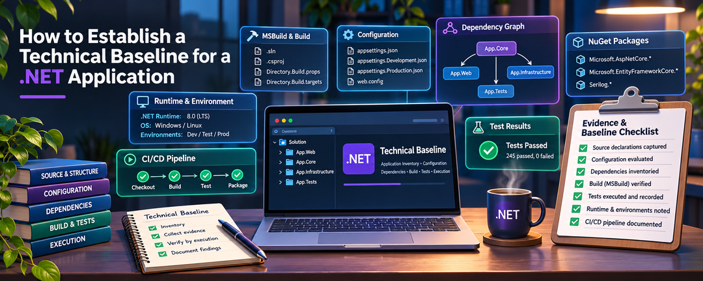

Before modernizing a .NET application, we need to understand its existing technical foundation.

That sounds straightforward, but a .NET application's technical characteristics aren't necessarily defined in one place.

Its target frameworks may be declared in individual project files. Compiler settings may be inherited from MSBuild properties. Dependencies may be managed through NuGet configuration files. Build behavior can depend on installed tooling, environment variables, imported targets, and continuous integration workflows.

Even when an application builds successfully, those details may not be fully documented.

**Establishing a technical baseline gives us a repeatable, evidence-backed picture of how the application is assembled, configured, built, tested, and delivered today.**

This article explains what to collect, how to organize it, and how to distinguish source declarations, tool-evaluated configuration, and executed verification. The method applies to applications already using current .NET tooling as well as older project systems.

This is part of the [Staying Current with .NET](/series/staying-current-with-dotnet/) series and follows the [Modernizing .NET introduction](/post/2026/11/11/modernizing-dotnet-evidence-driven-journey-with-recordsift).

In a companion article, we'll apply the methodology to [RecordSift](https://github.com/infoconex/RecordSift), our .NET Framework 4.8 case study, using actual commands and output tied to identifiable source revisions.

For now, our objective is discovery—not improvement.

## What Is a Technical Baseline?

A technical baseline is a documented snapshot of an application's technical characteristics at a particular source revision. **Repeatable discovery** means another engineer can retrieve the identified inputs and repeat the investigation; it does not guarantee deterministic, byte-for-byte identical build artifacts.

It should describe the application's:

- Repository, solutions, and projects.
- Target frameworks, project formats, and compiler configuration.
- Project references and external dependencies.
- MSBuild and repository-wide configuration.
- Development tools, SDKs, runtimes, and build environment.
- Dependency restoration and package management.
- Automated testing infrastructure.
- Continuous integration and delivery workflows.
- Packaging, deployment, and runtime requirements.
- Existing compatibility verification mechanisms.

A useful baseline also identifies where each observation came from and whether it has been independently verified.

For example, a project file might declare that an application targets .NET Framework 4.8. That is a source-inspected fact.

A successful build using a particular MSBuild version on a Windows runner is a different fact, supported by execution evidence.

Neither observation replaces the other.

The goal is an accurate technical record that another engineer can inspect, understand, and independently investigate.

## How to Record Evidence

A baseline is most useful when it identifies **how** each important observation was established.

| Evidence method | What it establishes |
|---|---|
| **Source-inspected** | A file, declaration, reference, or documented instruction exists at a specified revision |
| **Tool-evaluated** | A tool resolved properties, items, or dependency information under recorded inputs, without necessarily establishing a successful build or test |
| **Executed** | A restore, build, test, packaging, deployment, or other verification operation ran and produced a recorded outcome |

**Classify a finding by what the evidence establishes, not just whether a command was invoked.** Querying an MSBuild property establishes evaluated configuration, not a successful build. A NuGet restore provides an executed restore outcome and may also produce tool-resolved dependency evidence. Its generated `project.assets.json` represents the resolved graph from that restore; a committed `packages.lock.json` can be inspected as a source artifact, but its presence alone does not verify a current restore or locked-mode enforcement.

**Provenance is separate from evidence method.** Evidence may be collected during this discovery or carried forward from an earlier investigation. A previous test run remains executed evidence, but only for the source revision, environment, and scope it actually covered. It does not automatically verify the current baseline.

For each material observation, retain a compact record:

| Field | What to record |
|---|---|
| Observation and scope | The technical fact and the project, framework, configuration, or workflow it describes |
| Source identity | Repository and commit SHA, plus local or external changes if relevant |
| Evidence location | Source path, tool output, workflow run, test report, or artifact |
| Method and context | Inspection, evaluation, or execution; commands, relevant arguments, tool versions, environment, and date as applicable |
| Result and status | Observed value or outcome; verified for its stated scope, not verified, incomplete, or conflicting |
| Origin | Collected now or reused from an earlier record, with its original revision and environment |

Document required environment variables, package-feed authentication, and credential sources **without recording secret values**. A failed check, missing artifact, or unresolved discrepancy is a valid finding.

This evidence model applies to every discovery category that follows.

## 1. Establish the Source of Truth

Technical discovery should begin by identifying the exact source being examined.

Record the repository URL, branch or tag, full Git commit SHA, discovery date, and working-tree state.

An immutable commit is particularly important because branch names are movable references.

Two engineers examining the same branch on different dates may be looking at different code.

A technical baseline should therefore be associated with a specific commit rather than relying solely on a branch name.

If uncommitted or untracked files affect the investigation, preserve the relevant diff or identify those inputs explicitly. Record submodule revisions, linked repositories, generated source, and externally supplied build inputs when applicable. A commit SHA cannot reproduce local modifications that were never captured.

## 2. Understand the Solution and Project Structure

A .NET application's solution and project files provide the starting point for understanding how it is assembled.

Begin by identifying every relevant solution (`.sln` or `.slnx`), solution filter (`.slnf`), and project, including projects that aren't referenced by the primary solution. A solution filter describes a selected subset of a solution; it is not a separate project graph.

For each project, document:

| Characteristic | Information to collect |
|---|---|
| Project identity | Name, path, and technical role |
| Project type | Library, executable, web application, test project, etc. |
| Project format | Non-SDK-style (traditional) or SDK-style |
| Target framework | Declared framework or frameworks |
| Language | C#, F#, Visual Basic, or another language |
| Compiler settings | Language version and applicable options |
| Build configuration | Debug, Release, platforms, and conditional variations |
| References | Project-to-project and assembly references |
| Outputs | Assemblies, executables, documentation, and other artifacts |

Not every project will use the same settings.

A solution might combine non-SDK-style and SDK-style projects, multi-targeted packages, and test projects targeting different frameworks. **Project format, target framework, and build toolchain are separate characteristics**: SDK-style projects can target .NET Framework.

The baseline needs to preserve those differences.

### Document project relationships

The relationship between projects is as important as the list of projects themselves.

Project references determine which components depend on others and contribute to the application's compilation structure.

A dependency diagram or project-reference table can make these relationships easier to understand.

We don't need to document every class or functional workflow. At this stage, we want to understand build dependencies, project output roles, and assembly boundaries.

## 3. Examine MSBuild and Compiler Configuration

.NET project files describe how source code is transformed into build outputs, but the effective build configuration can involve much more than the individual project file.

MSBuild properties and items may originate from:

- Individual project files.
- Imported `.props` and `.targets` files.
- Repository-wide configuration.
- SDK-provided imports and defaults.
- Conditional property groups.
- Environment variables.
- Command-line parameters.
- Custom build targets and generated inputs.

The technical baseline should identify those sources and document the settings relevant to the application.

Examples include target frameworks, language versions, nullable-reference settings, assembly generation, output paths, compilation constants, warnings, analyzers, and platform targets.

### Declared, evaluated, and executed configuration

An important distinction is the difference between a setting declared in source and the value MSBuild evaluates for a particular invocation.

A project may declare one value while imported files, conditions, environment variables, command-line properties, or SDK selection produce another.

**Source inspection identifies declarations. MSBuild evaluation resolves properties and items under specified inputs. Target execution can subsequently modify properties, items, and build outputs.** An evaluated value is therefore not always the value observed after execution. Microsoft documents the distinction in [how MSBuild builds projects](https://learn.microsoft.com/en-us/visualstudio/msbuild/build-process-overview) and [how to inspect evaluated properties and items](https://learn.microsoft.com/en-us/visualstudio/msbuild/evaluate-items-and-properties).

Record the entry point (Visual Studio, `MSBuild.exe`, or the `dotnet` CLI), MSBuild/SDK versions, project and target framework, configuration, platform, relevant command-line arguments, working directory, and environment when they affect the result.

Also record custom targets, code generation, and other nonstandard inputs where they affect compilation or artifact generation.

## 4. Inventory Repository-Wide Configuration

Many .NET repositories use files that apply configuration across multiple projects.

Examples include:

| Configuration | Purpose |
|---|---|
| `global.json` | Controls applicable .NET SDK selection, roll-forward, and MSBuild project SDK versions; .NET 10 also supports SDK search paths and test-runner selection |
| `Directory.Build.props` | Defines shared MSBuild properties |
| `Directory.Build.targets` | Defines shared MSBuild targets |
| `Directory.Packages.props` | Provides central package versions for applicable `PackageReference` projects |
| `nuget.config` | Configures NuGet sources and related behavior |
| `.editorconfig` | Defines code-style and formatting settings |
| `Directory.Build.rsp` or other response files | Supplies default command-line MSBuild options; not applied to builds inside the Visual Studio IDE |

These mechanisms have different search, import, and precedence rules. For example, [MSBuild directory imports](https://learn.microsoft.com/en-us/visualstudio/msbuild/customize-by-directory) depend on project location and import context, while [`global.json` resolution](https://learn.microsoft.com/en-us/dotnet/core/tools/global-json) depends on the tool invoking the SDK. [MSBuild response files](https://learn.microsoft.com/en-us/visualstudio/msbuild/msbuild-response-files) affect command-line invocations, not IDE builds.

Where applicable, also inventory `.globalconfig`, analyzer rulesets, `.config/dotnet-tools.json` local tool manifests, and solution-level build configuration. Capture locations, relevant settings, and applicability without assuming every repository has them.

It should also record when a relevant configuration mechanism isn't present.

**An absent file is an inventory observation, not a recommendation to introduce it.**

That distinction keeps discovery objective.

## 5. Document Dependencies and NuGet Configuration

NuGet dependencies are another major part of the technical foundation.

Inventory how packages are declared, restored, and resolved: direct references, relevant transitive dependencies, package sources, version constraints, and the restore tool and context.

Two common management formats represent dependencies differently:

- **`packages.config`** records a flat list of installed packages, including dependencies installed on behalf of other packages.
- **`PackageReference`** normally declares top-level dependencies; restore resolves the transitive graph. [Central Package Management](https://learn.microsoft.com/en-us/nuget/consume-packages/central-package-management), when enabled, manages versions for `PackageReference` through `Directory.Packages.props`. It is not a third parallel dependency format.

A manifest describes declared dependencies. A successful restore is **executed evidence that restore completed**; it does not by itself document the complete resolved graph. For `PackageReference`, generated artifacts such as `obj/project.assets.json` record the resolved graph. An applicable `packages.lock.json` records resolved versions and relationships; record separately whether restore was run in **locked mode**, which enforces the lock file rather than permitting dependency changes. For `packages.config`, the manifest already lists a flat set of installed packages; record it alongside the actual restore command, tool, relevant configuration, and outcome.

[NuGet configuration](https://learn.microsoft.com/en-us/nuget/consume-packages/configuring-nuget-behavior) can come from directory, user, or machine scope, so a repository's `nuget.config` is not necessarily the complete effective source configuration. Record the applicable configuration and any explicit configuration file or command-line overrides.

See [NuGet dependency resolution](https://learn.microsoft.com/en-us/nuget/concepts/dependency-resolution) and [PackageReference and lock files](https://learn.microsoft.com/en-us/nuget/consume-packages/package-references-in-project-files).

Dependencies aren't limited to NuGet packages. Native libraries, local assemblies, externally supplied binaries, and system-provided components may also be necessary to compile or execute an application. Document those when applicable.

## 6. Identify the Development and Build Environment

An application can depend on tools that aren't fully represented in source control, although some tooling is captured through project references or local `.config/dotnet-tools.json` manifests.

The development and build environment may include:

- Operating system and architecture.
- Installed .NET SDKs and runtimes.
- .NET Framework targeting packs.
- MSBuild implementation and version.
- Visual Studio or Visual Studio Build Tools.
- C# and other language compilers.
- NuGet tooling.
- Test runners.
- Environment variables and external build prerequisites.

Documenting the environment helps distinguish application configuration from assumptions supplied by a particular machine.

For example, an installed .NET SDK and an installed .NET Framework targeting pack serve different purposes.

Likewise, the `dotnet` CLI and Visual Studio MSBuild may differ in project-type support or installed components; record the actual build entry point.

A technical baseline should record the actual tools and versions associated with successful or unsuccessful operations.

When the environment hasn't been inspected, that should be stated rather than inferred from project configuration. Identify required variables and authentication prerequisites without copying credentials or tokens into the baseline.

## 7. Document the Build Process

Once the projects, configuration, dependencies, and tooling are identified, we need to understand how the application is built.

The baseline should capture the build entry points, commands, configurations, required environment, and expected outputs.

This includes any restore prerequisites, code generation, custom targets, prebuild or postbuild operations, and scripts used to coordinate the process.

Apply the evidence model to three separate questions:

- **Configured inputs:** What projects, configurations, and build steps are declared in source?
- **Documented invocation:** Which commands are specified by scripts, developer instructions, or CI definitions?
- **Observed outcome:** Which commands actually ran, against what source revision and environment, and with what results?

The distinction is especially important when an application has multiple build configurations or target frameworks.

A successful Debug build does not automatically establish that Release packaging succeeds, and a successful build of one project does not necessarily cover the full solution.

## 8. Inventory Automated Testing

Testing infrastructure is part of the application's technical foundation.

For discovery, our primary objective is to understand how tests are organized, built, selected, and executed—not to reproduce their functional specifications.

Document the testing frameworks, test projects, test runners, supporting packages, test categories, and execution entry points.

Identify how tests are run locally and in CI, whether filtering or parallel execution is supported, and where results and coverage artifacts are recorded.

Existing results should be associated with the exact source revision, test environment, and command that produced them.

Test totals can be useful, but they need context.

A count of 500 passing tests doesn't tell us whether all relevant test assemblies were included or whether every project participated in the execution.

The baseline should distinguish configured test infrastructure from observed test execution.

## 9. Examine CI/CD, Packaging, and Runtime Requirements

Continuous integration workflow **definitions** document the intended automation for restoring dependencies, selecting toolchains, building, testing, validating artifacts, and preparing releases. Completed workflow runs and retained logs are separate evidence of the steps actually executed and their outcomes.

For each relevant workflow, identify its source-controlled definition or externally managed configuration, including its location and revision when available. Record triggers, runners, tool versions, principal commands, validation steps, artifacts, and available execution results.

Pay attention to differences between local development and CI.

For example, an application may use a PowerShell script locally while GitHub Actions invokes a separate build and test sequence.

Both should be represented in the baseline.

Deployment and distribution details also matter.

A class library may produce NuGet packages, while another application may publish a web deployment, desktop installer, Windows service, or container image.

Document the actual delivery mechanism, packaging inputs, output artifacts, environment assumptions, and available release evidence.

Include **runtime and hosting requirements** where applicable: .NET Framework or .NET runtime versions, operating systems, architectures, hosting components such as IIS, native dependencies, runtime identifiers, deployment mode (for example, framework-dependent or self-contained), and configuration such as `app.config`, `web.config`, or `runtimeconfig.json`. Distinguish requirements declared in source from those verified through execution or deployment.

Avoid treating a package definition, a locally generated artifact, and a published release as interchangeable evidence.

## 10. Identify Existing Compatibility Evidence

Some applications—particularly libraries and shared components—maintain technical contracts that can be inspected independently of their functional requirements.

Examples include public assembly APIs, assembly identities, generated XML documentation, serialized data formats, package contents, configuration contracts, and consumer integration checks.

The technical baseline should identify which applicable contracts are documented and how they are currently verified. Examples include source or binary API comparisons, approval snapshots, and assembly metadata checks; no particular validation tool is mandatory.

For instance, a repository may contain a public API snapshot and an automated command that compares it against compiled assemblies.

The baseline should record both the snapshot and the verification mechanism.

It should also indicate whether that mechanism has been executed against the selected source revision.

This isn't an assessment of whether the existing verification is sufficient. It is an inventory of the compatibility evidence already available.

## 11. Reconcile Evidence and Outstanding Gaps

Before finalizing the inventory, compare current declarations, evaluated values, and execution records for the same technical areas. Do not silently combine observations from different source revisions, toolchains, configurations, or test scopes.

Record conflicting information, missing source inputs, failed commands, incomplete test execution, and unexecuted verification as explicit findings. A baseline does not have to claim every check passed; it must report what is known, which evidence applies, and where verification remains outstanding.

Use the evidence record introduced earlier rather than duplicating test matrices, requirements, or workflow logs inside the baseline.

## 12. Produce a Reproducible Baseline

Collecting information is only part of the process. The documentation should allow another engineer to repeat the **investigation** under identified source, tooling, and environment inputs, without promising identical build binaries or success under different conditions.

I prefer a concise discovery overview supported by a detailed technical baseline.

The overview establishes the application identity, source revision, discovery scope, and links to the technical evidence.

The baseline contains the actual inventory, grouped into consistent technical categories.

For a substantial application, it should be possible to navigate directly to project configuration, dependencies, build tooling, testing, CI/CD, packaging, runtime requirements, and compatibility evidence without searching through unrelated documentation.

The record should avoid duplicating material already maintained elsewhere.

For example, a repository may already document its functional requirements, architecture, and test scenarios. The technical baseline can reference those records where relevant without recreating them.

### How do we know the baseline is useful?

Another engineer should be able to retrieve the same source, identify the applicable tools, understand the build and dependency configuration, find the documented commands, locate the verification evidence, and distinguish established facts from outstanding gaps.

The baseline should also be dated and tied to an immutable source revision so that future discoveries can be compared with it.

A technical baseline is a snapshot, not an assertion that the application will never change.

## Discovery Is Not Assessment

There is a deliberate boundary to this exercise.

During discovery, we may encounter non-SDK-style project formats, repeated build settings, particular dependency versions, absent configuration files, or differences between local and CI execution.

We should document those observations.

But deciding whether they should change requires a different activity.

Modernization assessment considers applicability, alternatives, benefits, risks, compatibility, effort, and priorities.

Discovery establishes the facts on which those decisions can be based.

Separating the activities prevents a technical inventory from becoming a collection of recommendations before the application's current state has been adequately established.

It also makes the baseline useful for applications that are already using modern .NET versions, SDK-style projects, and contemporary build tooling.

## Conclusion

A useful technical baseline documents the projects, configuration, dependencies, tooling, build and test infrastructure, runtime requirements, and delivery process of an application at an identified source revision.

It distinguishes what source declares, what tools evaluate, and what has actually been executed. It also preserves the context needed to interpret historical evidence and outstanding gaps.

That gives another engineer a repeatable way to investigate the same technical state without mistaking configuration for verified outcomes.

In the companion RecordSift walkthrough, we'll show the real commands, recorded results, and baseline produced by applying this method. Assessment of modernization opportunities follows as a separate article.
